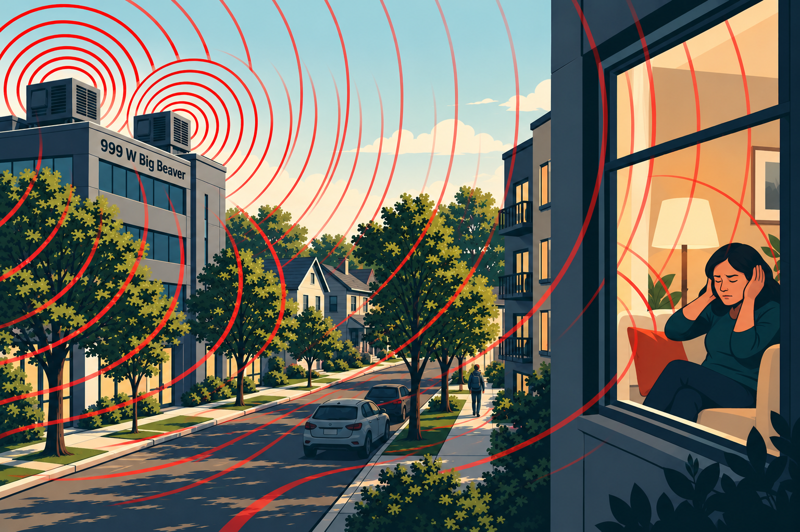

# Heard enough from 999 W. Big Beaver?

Constant rooftop noise from **999 W. Big Beaver Rd** has droned for years in our homes, yards, and businesses. It's unwelcome and unhealthy, and because it comes from above, it's often the loudest noise.

Should 999 W. Big Beaver keep its noise out of our ears? If so, please act:

**1. Call Troy Police: 248-524-3477.** Ask for your own case number and what they'll do to stop it.

**2. Call the owner: A.F. Jonna, (248) 593-6200.** Ask who manages the equipment and what they'll do.

**3. Email Troy Code Enforcement: [CODE ENFORCEMENT EMAIL].**

---

Flyer by <MichaelRWolf@att.net>. Connect if you'd like to coordinate efforts.
