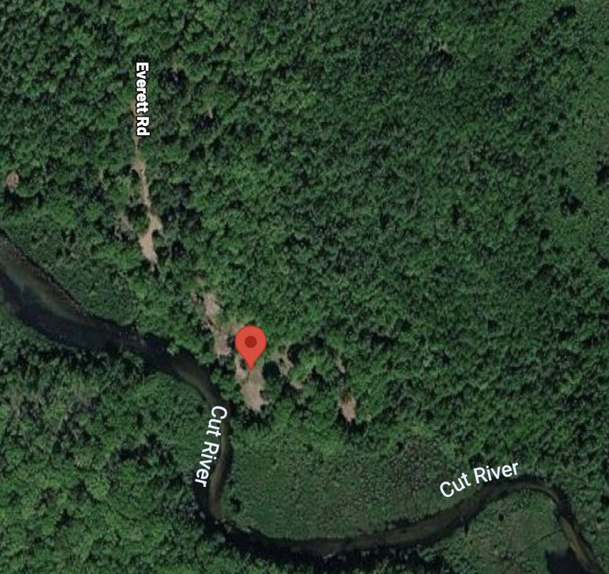
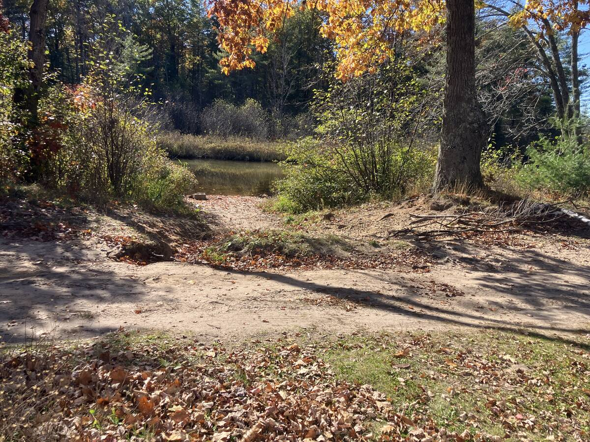
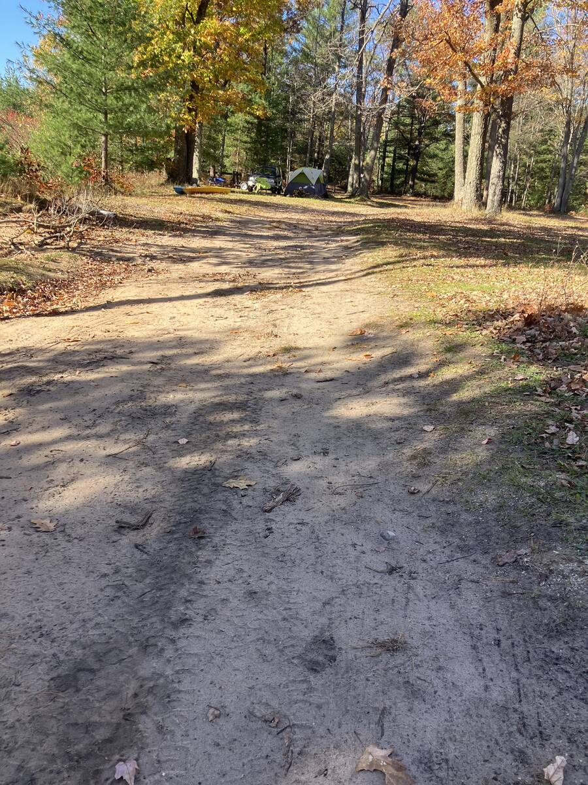
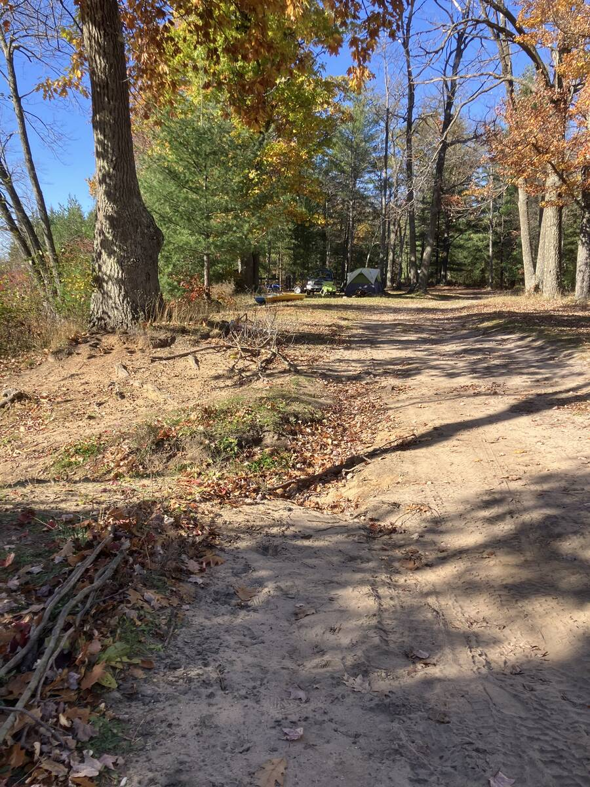
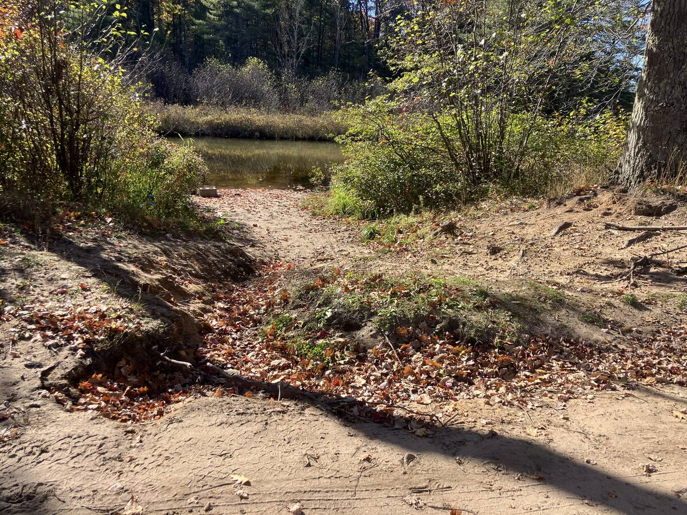
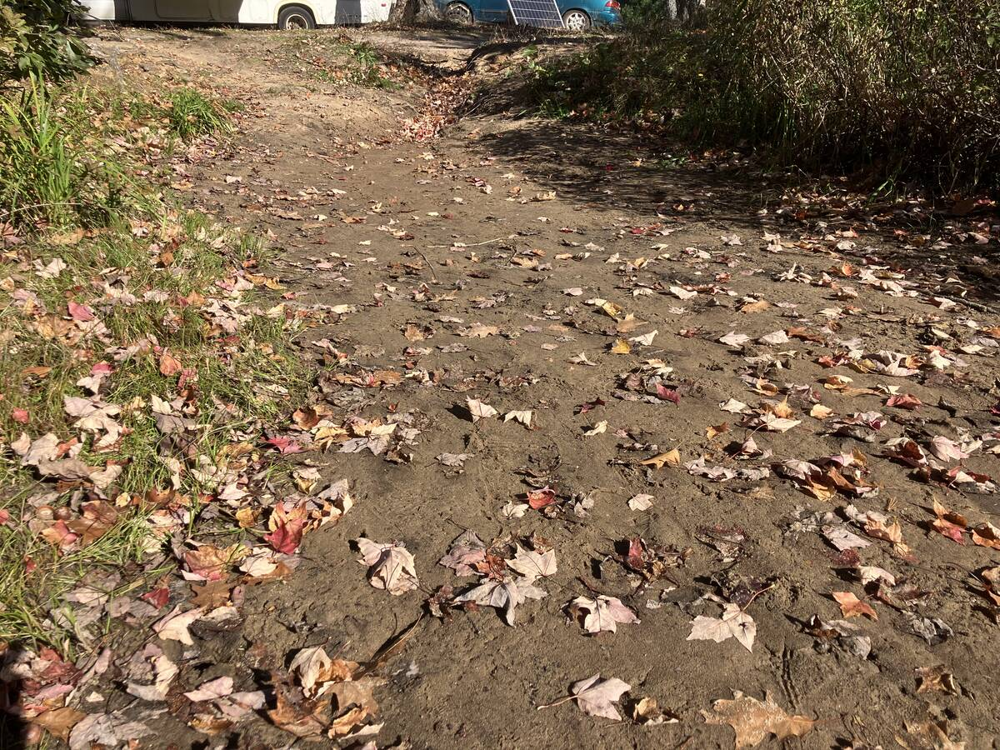

# Erosion Site at The Cut: Outlet Plan for the Everett Road Two-Track

**To:** Jason Lewicki, Forest Manager, Roscommon Forest Management Unit, Michigan DNR\
**Authors:** Michael Wolf (volunteer) and Claude (an AI assistant)\
**Contact:** Michael Wolf, <MichaelRWolf@att.net>, 206-679-7941\
**Date:** October 28, 2026\
**Subject:** Gully at The Cut (end of Everett Rd) -- outlet plan for your review\
**Address:** South terminus of Everett Road, Gerrish Township, Roscommon County, MI 48653

In this memo, "I" is Michael.

---

Jason,

Thank you for stopping by the site on Thursday, October 22. The summary below fits on one screen, and the detail is there if your crew wants it. Everything here is a volunteer's brainstorm, co-written with Claude, and needs your crew's vetting before anyone moves a shovel of sand.

## Summary

- **Erosion site:** A sand gully at the end of the access two-track carries runoff from the tread and the campsites into The Cut. Headcuts have reached the tread, and vehicles are beginning to detour uphill, which is a chance to fix it before the damage spreads.
- **Constraint:** I walked the contributing area. The water has nowhere else to go, so diversion (water bars, lead-outs) is off the table. The plan designs the outlet instead.
- **Approach, in four layers along the flow path:** (1) a hardened broad dip that spreads the flow, (2) a hard sill that pins the headcut, (3) 3-5 low brush check dams that step the water down, (4) a clear, drivable route that keeps traffic on the tread.
- **Main risks:** flanking, undercutting, plunge-pool scour, and leakage through clean sand, which will not seal the way silt does.
- **Offering:** use this as a starting point, a critical review, or ideas to bounce off as you create a professional work plan. Eat the fish, spit out the bones. I am no longer in the area, but I am happy to do what I can: clarifying the proposal, adding pictures, or providing it in a different format.

Photos with captions are in Appendix A.

## Site Location

South terminus of Everett Road, Gerrish Township.

- Coordinates: 44.4283167, -84.6535861
- Plus Code, full: 86PQC8HW+8H (works pasted alone into Google Maps search)
- Plus Code, short: C8HW+8H Roscommon, MI (the town is required)
- Map by coordinates: <https://www.google.com/maps?q=44.4283167,-84.6535861>
- Map by Plus Code: <https://www.google.com/maps?q=86PQC8HW%2B8H>
- Sanity check: the pin should sit on The Cut, south of Roscommon, at the south end of Everett Road. If a typed code lands elsewhere, use the links instead.

<!-- markdownlint-disable-next-line MD033 -->

Caption: Satellite view (Google Maps). The pin marks the erosion site. The two-track runs down from Everett Rd at the upper left, and the bare sand at the pin is the gully draining toward The Cut (labeled "Cut River" on the map).

## Brief Site History

- Many years: the bank has retreated about 30 feet and built a delta in the stream.
- Last 1-2 years: headcuts reached the two-track tread.
- Now: drivers are starting to detour uphill around the damage.

## Goals

1. Take surges gently, so the gully stops widening and the headcut stops advancing into the tread.
2. Let the two-track keep draining to this low spot without multiplying the force of the water there.
3. Let considerate campers and normal traffic use the two-track without making any of it worse.

In short: keep the sand on the two-track and out of The Cut.

## The Plan, Layer by Layer

### 1. Spread the flow at the tread

- Shape a broad, shallow dip across the two-track where it meets the gully, and harden it (coarse stone or gravel over geotextile, if your crew approves). Water arrives as a sheet, not a rut.
- Fill or spread existing downhill ruts. Add no new ditches, turnouts or ruts that collect more water and deliver it to the same spot.

### 2. Pin the headcut

- Set a hard sill (log or stone) at the lip of the main headcut so it cannot retreat toward the tread.
- Lay back vertical faces to about 2:1, cover with brush (butt ends uphill), stake, and mulch. Add native live stakes where suitable.

### 3. Step the water down

- Build 3-5 low brush check dams, 6-12 inches tall, keyed 6+ inches into bed and banks. This is the beaver-dam idea, minus the beavers.
- Center notch lower than the ends. Every crest below the two-track edge, so flow cannot flank into the ruts.
- Space by elevation: base of the upper dam about level with the crest of the lower dam.
- Armor each landing with a brush mat or rock.
- Put a filter on each upstream face (coir or burlap mat, leaf pack, or fabric). This is the key adaptation for sand.
- Optional: 2x6 board weirs with a center notch where foot traffic wants a path. Offset the tread from the notch, anchor deeply, and use rated lumber.
- Optional: sandbags as temporary reinforcement at the weakest spot only. They degrade, so stack as a stepped pyramid and do not build a footbridge on them.

### 4. Keep traffic on the tread

- Make the hardened dip the obvious, drivable route, so there is no reason to detour.
- Block the uphill detour with logs or boulders, so the dip is the only comfortable path. If the two-track needs a sign to be used correctly, the design is not finished, so the plan uses design cues and physical constraints instead.
- Sand soaks water quickly, so a shallow pocket above the dip may absorb small storms. That is a guess for your crew to confirm.

## Failure Modes We Are Designing Against

1. **Flanking:** key the ends 6+ inches into the banks, and keep the banks higher than the notch.
2. **Undercutting and piping:** set the base in a shallow trench, with the filter on the upstream face.
3. **Plunge-pool scour:** wide, shallow overflow, an armored landing, small steps with long runs.
4. **Surge overtopping:** size the notch for the storm, not the trickle, and add an armored emergency overflow.
5. **Sediment fill:** clear behind notches, or let it fill and become a terrace.

## Phases (for the Crew to Adjust)

### Phase 0: Confirm and survey

- [ ] Coordinate with the appropriate organizations, and confirm which approvals apply (possibly state soil erosion or inland waters permits)
- [ ] Walk the flow path, headcuts and banks with the crew
- [ ] Estimate drainage area, slope and storm flow from maps and LiDAR (Claude can do the arithmetic, and your crew checks it in the field)
- [ ] Mark fixed photo points

### Phase 1: Dip and traffic

- [ ] Shape and harden the broad dip
- [ ] Fill or spread downhill ruts
- [ ] Block the detour with logs or boulders, so the dip is the easy route

### Phase 2: Headcut

- [ ] Sill at the lip, laid-back faces, brush, mulch, live stakes

### Phase 3: Channel

- [ ] Brush check dams with filters and armored landings
- [ ] Optional board weirs or temporary sandbags

### Phase 4: Watch and maintain

- [ ] Inspect after every heavy rain for the first season
- [ ] Does water go over the notch or around the ends? Any gap or wet spot at a dam base? A pool deepening at a landing? A new headcut above the top dam? New tracks around the repair?
- [ ] Repair flanking, undercutting and scour first, then clear sediment
- [ ] Re-photograph from the fixed points each season

## Questions for Your Crew (Optional)

1. Which organizations need to be coordinated with, and in what order?
2. Which approvals apply, if any?
3. Is there a state or unit standard for check dams, hardened dips or low-water crossings that we should follow (stone size, fabric, spacing)?
4. What did we get wrong? Please mark up anything that would not survive real sand and real rain.

## How This Was Made, and What It Could Do for Your Crew

Michael talked through ideas, and Claude restated them, critiqued them, and turned them into this plan. The same approach could draft permit questions, materials lists, work-day briefings, inspection logs and site-photo descriptions for your crew, with your expertise in the driver's seat. Claude cannot see the site or replace field judgment, and it is only as good as the amateur feeding it, so please treat all of it as a draft.

Thank you, Jason, and thank you to everyone on your crew, for the work you do. It makes a huge difference to us, and I am sure to many others, who count natural resources (AKA Momma Nature) as a critical source of joy for a life well lived.

## Contact

Michael Wolf, co-author (volunteer)\
<MichaelRWolf@att.net>\
206-679-7941

Claude (Sonnet 5.5), co-author, an AI assistant made by Anthropic\
No phone or email of its own. Reach it through Michael, or learn more at <https://claude.ai>

## Appendix A. Site Photos

All five photos were taken by Michael Wolf at the same location (44.4283, -84.6536). Captions were first written with Claude, which looked at each photo directly, then reviewed by Michael, and are revised here to tie each photo to the plan. Water is assumed to flow downhill: from the campsites, across the two-track, through the gully, over the delta, and into the stream. No measurements are claimed. Statements about what a photo implies for the plan are hypotheses for the crew to confirm.

### Photo 1 (IMG_7473): The Outlet

Caption: Gully on the access two-track, looking toward The Cut. Bare sand carries runoff and sediment into the water, and a headcut has started at the two-track edge. All the water arrives here, so this is where the plan concentrates its work: a broad hardened dip across the tread, a hard sill at the lip of the headcut, and low steps below. A grassy sand island splits the flow into two paths. Tire tracks cross the damage, showing the route drivers take.

### Photo 2 (IMG_7474): The Uphill Edge of the Two-Track

Caption: The uphill edge of the access two-track, rising from the damage toward the campsites. Rutted sand and leaf litter show the tread that drains to the gully, and I checked that there is no other place for this water to go. The ruts and bare sand also show the line drivers take around the damage. The plan keeps traffic on a hardened, drivable route through the dip so there is no reason to detour, and it blocks the detour.

### Photo 3 (IMG_7475): The Downhill Edge of the Two-Track

Caption: The downhill edge of the access two-track, between the damage and The Cut, looking back up toward the campsites. Exposed sand and roots on the cut bank at the left edge show the erosion moving into the two-track shoulder. This kind of bank would be laid back to about 2:1, covered with brush, and staked. The branch debris along the edge is preliminary dam material for the brush check dams, and would need a filter layer, since sand will not seal itself the way silt does.

### Photo 4 (IMG_7476): The Headcut

Caption: Closer view of the headcut at the two-track edge. Sand has dropped from the tread, and water splits around a grassy sand mound before reaching the stream. This is the most likely place for a hard sill (log or stone) at the lip, to keep the headcut from retreating toward the tread. Below it, the flow would step down in several small drops rather than one big one.

### Photo 5 (IMG_7478): The Source

Caption: Sandy two-track surface with a runoff channel from the campsite. Dark, damp sand and a shallow depression show the flow path toward the tread. This is a source that cannot be diverted, so the plan fills or spreads downhill ruts like this one and avoids adding ditches or turnouts that would collect more water and deliver it to the same spot.
